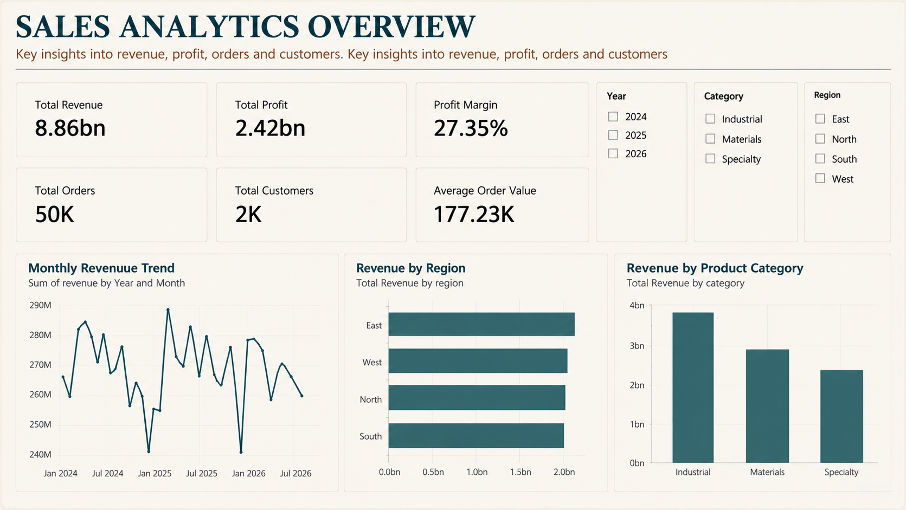
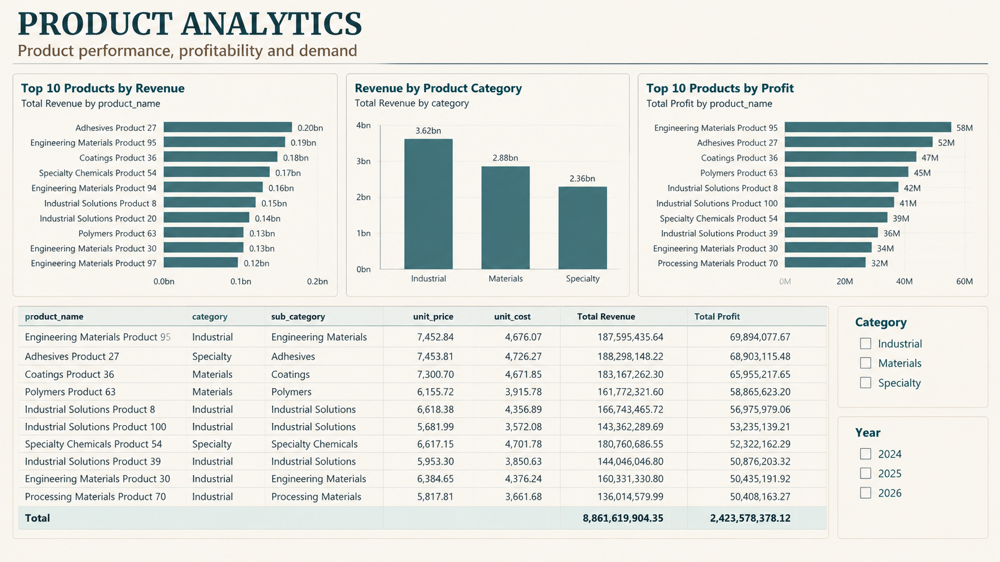

# Business Intelligence Sales Analytics Platform

An end-to-end Business Intelligence platform that transforms raw sales data into a structured PostgreSQL data warehouse and interactive Power BI dashboards. The project demonstrates data generation, data quality management, ETL development, dimensional modeling, SQL analytics, and business reporting.

## Project Overview

This project simulates a sales analytics environment for a manufacturing and specialty materials business. It generates synthetic sales data, introduces data-quality issues, cleans the datasets, loads them into PostgreSQL, transforms the staging data into a star-schema warehouse, and visualizes key business metrics in Power BI.

The platform is designed to answer questions such as:

- Which products generate the highest revenue and profit?
- Which regions perform best in sales?
- How do sales and profitability change over time?
- Which product categories contribute the most revenue?
- What is the overall profit margin?
- How do customer segments and sales channels contribute to performance?

**Important:** All business data and financial results in this project are synthetic and are not actual company data.

## Technology Stack

| Technology | Purpose |
|---|---|
| Python | Data generation, cleaning, and ETL |
| Pandas | Data manipulation and transformation |
| NumPy | Numerical operations |
| Faker | Synthetic customer data generation |
| PostgreSQL 18 | Relational database and data warehouse |
| SQLAlchemy | Python-to-PostgreSQL connectivity |
| Psycopg2 | PostgreSQL database driver |
| python-dotenv | Environment-based database configuration |
| SQL | Data modeling, validation, and analytics |
| Power BI Desktop | Interactive dashboards and business reporting |
| DAX | Dashboard measures and KPI calculations |
| Git and GitHub | Version control and project hosting |
| VS Code | Development environment |

## Architecture

The project follows a staged ETL architecture.

```text
Synthetic Data Generation
          |
          v
     Raw CSV Files
          |
          v
 Data Quality Issues
          |
          v
     Data Cleaning
          |
          v
    Processed CSVs
          |
          v
 PostgreSQL Staging Tables
          |
          v
 Warehouse Transformation
          |
          v
 PostgreSQL Star Schema
          |
          v
     SQL Analytics
          |
          v
   Power BI Dashboards
```

The ETL workflow separates data generation, quality management, staging, warehouse loading, and reporting into distinct steps.

## Dataset

The project generates the following synthetic datasets.

| Dataset | Approximate records | Description |
|---|---:|---|
| Customers | 2,000 | Customer profiles, regions, industries, and segments |
| Products | 100 | Product categories, unit prices, and unit costs |
| Orders | 50,000 | Sales transactions, quantities, dates, and channels |
| Returns | Approximately 2,000 | Simulated product returns and reasons |

The generated sales data covers January 1, 2024, through September 30, 2026.

### Data Quality Scenarios

The project introduces and addresses data-quality problems, including:

- Duplicate customer records.
- Missing customer industry values.
- Inconsistent region formatting.
- Whitespace in customer and product names.
- Invalid or missing numeric values.
- Invalid dates and missing critical order fields.
- Non-positive order quantities.

The cleaning pipeline standardizes fields, removes duplicate customer IDs, validates numeric columns, converts dates, and excludes invalid orders.

## Repository Structure

```text
Business-Intelligence-Sales-Analytics/
│
├── data/
│   ├── raw/
│   │   ├── customers.csv
│   │   ├── customers_messy.csv
│   │   ├── products.csv
│   │   ├── orders.csv
│   │   └── returns.csv
│   │
│   └── processed/
│       ├── customers_clean.csv
│       ├── products_clean.csv
│       ├── orders_clean.csv
│       └── returns_clean.csv
│
├── docs/
│   └── Screenshots/
│       ├── Screenshot-1.png
│       ├── Screenshot-2.png
│       ├── Screenshot-3.png
│       ├── Screenshot-4.png
│       ├── Screenshot-5.png
│       ├── Screenshot-6.png
│       └── Screenshot-7.png
│
├── etl/
│   ├── generate_data.py
│   ├── create_data_issues.py
│   ├── clean_data.py
│   ├── load_data.py
│   └── load_warehouse.py
│
├── notebooks/
│
├── powerbi/
│   └── sales_analytics.pbix
│
├── sql/
│   ├── schema.sql
│   └── analytics.sql
│
├── .env                  # Local database credentials; not committed
├── .gitignore
├── requirements.txt
└── README.md
```

Generated CSV files are local pipeline artifacts and may be excluded from Git by `.gitignore`. Run the generation and cleaning steps to recreate them.

## Prerequisites

Install the following software before setting up the project:

1. Python 3.12 or another compatible Python version.
2. PostgreSQL 18.
3. pgAdmin 4 or another PostgreSQL SQL client.
4. Power BI Desktop.
5. Git.
6. Visual Studio Code (recommended).

Confirm that Python and Git are available:

```powershell
python --version
git --version
```

## Installation and Setup

### 1. Clone the repository

```powershell
git clone https://github.com/Nihal-agarwal-10/business-intelligence-sales-analytics.git
cd business-intelligence-sales-analytics
```

Open the project folder in VS Code.

### 2. Create a virtual environment

On Windows PowerShell:

```powershell
py -3.12 -m venv .venv
.\.venv\Scripts\Activate.ps1
```

If Python 3.12 is unavailable, use an installed compatible Python version.

If PowerShell blocks virtual environment activation, you can invoke the environment's Python executable directly:

```powershell
.\.venv\Scripts\python.exe --version
```

### 3. Install dependencies

```powershell
python -m pip install --upgrade pip
pip install -r requirements.txt
```

The dependencies include the libraries required for data generation, data cleaning, and database connectivity.

### 4. Configure PostgreSQL

Start PostgreSQL and create a database named:

```text
sales_analytics
```

You can create it through pgAdmin or run the following command from a PostgreSQL administrative connection:

```sql
CREATE DATABASE sales_analytics;
```

Connect to the new database in pgAdmin before executing the project SQL files.

### 5. Configure environment variables

Create a `.env` file in the repository root.

Add your local PostgreSQL connection settings:

```dotenv
DB_HOST=localhost
DB_PORT=5432
DB_NAME=sales_analytics
DB_USER=postgres
DB_PASSWORD=your_local_postgresql_password
```

Replace the example password with your own PostgreSQL password. Do not commit real credentials to GitHub.

The Python scripts read these variables through `python-dotenv`.

### 6. Generate synthetic data

From the repository root, run:

```powershell
python etl/generate_data.py
```

This generates the initial customer, product, order, and return datasets in `data/raw/`.

### 7. Introduce data-quality issues

Run:

```powershell
python etl/create_data_issues.py
```

This step prepares the intentionally imperfect customer dataset used by the cleaning workflow. The cleaning script expects `data/raw/customers_messy.csv` to exist.

### 8. Clean the datasets

Run:

```powershell
python etl/clean_data.py
```

The script cleans the raw datasets and writes the processed CSV files to `data/processed/`.

Expected outputs include:

- `customers_clean.csv`
- `products_clean.csv`
- `orders_clean.csv`
- `returns_clean.csv`

### 9. Create the warehouse schema

Open pgAdmin 4 and connect to the `sales_analytics` database.

Open the Query Tool, load `sql/schema.sql`, and execute it.

The schema defines five warehouse tables:

- `dim_customer`
- `dim_product`
- `dim_date`
- `dim_sales_channel`
- `fact_sales`

**Fresh database requirement:** Execute the schema creation step before loading data into the warehouse. The schema script uses `CREATE TABLE` statements without `IF NOT EXISTS`, so do not execute it again against an already populated database without first reviewing the existing tables.

### 10. Load staging tables

Run:

```powershell
python etl/load_data.py
```

This script reads the processed customer, product, and order CSV files and loads them into PostgreSQL staging tables:

- `staging_customers`
- `staging_products`
- `staging_orders`

The staging tables are created or replaced by the loader.

### 11. Populate the data warehouse

Run:

```powershell
python etl/load_warehouse.py
```

The warehouse loader:

1. Validates the required staging and warehouse tables.
2. Checks for invalid staging orders and duplicate staging order IDs.
3. Loads customer and product dimensions.
4. Loads distinct sales channels.
5. Generates the date dimension for the staged order date range.
6. Validates dimension-key mappings.
7. Inserts sales records into `fact_sales`.
8. Prints final table row counts.

Database changes are performed within a transaction. If an exception occurs inside the transaction, its changes are rolled back.

Existing dimension keys are preserved when matching natural keys already exist. Existing fact rows are skipped when their `order_id` is already present.

**Note:** The current loader is designed for this project's synthetic dataset. It does not implement a complete slowly changing dimension strategy or automatically update existing dimension attributes when source values change.

### 12. Run analytical SQL queries

Open `sql/analytics.sql` in pgAdmin and execute the queries against the populated warehouse.

The script contains analytical queries for:

- Total revenue.
- Total cost.
- Total profit.
- Profit margin.
- Revenue by region.
- Profit by region.
- Top 10 products by revenue.
- Revenue by product category.
- Monthly revenue.
- Revenue by sales channel.

### 13. Open the Power BI dashboard

Open:

```text
powerbi/sales_analytics.pbix
```

in Power BI Desktop.

The report connects to the PostgreSQL warehouse. If prompted, configure the connection to match your local PostgreSQL server and database.

Verify that the PostgreSQL tables are accessible, then refresh the report if necessary.

## Data Warehouse Design

The warehouse uses a star schema with one fact table and four dimension tables.

```text
                dim_customer
                     |
                     |
dim_date ---- fact_sales ---- dim_product
                     |
                     |
              dim_sales_channel
```

### Dimension Tables

| Table | Purpose |
|---|---|
| `dim_customer` | Customer identifiers, names, geography, industry, and segment |
| `dim_product` | Product identifiers, category, subcategory, unit price, and unit cost |
| `dim_date` | Calendar attributes, including year, quarter, month, and week |
| `dim_sales_channel` | Distinct sales channel values |

### Fact Table

`fact_sales` contains transaction-level sales measures and foreign keys to the four dimensions.

Its columns include:

- `sales_key`
- `order_id`
- `date_key`
- `customer_key`
- `product_key`
- `channel_key`
- `quantity`
- `revenue`
- `cost`
- `profit`

The surrogate keys in the dimension tables allow the fact table to reference warehouse records independently of the source-system identifiers.

## Power BI Dashboards

The report contains two main analytical pages.

### 1. Executive Overview



Provides a high-level view of sales performance through:

- Total Revenue.
- Total Profit.
- Profit Margin.
- Total Orders.
- Total Customers.
- Average Order Value.
- Monthly Revenue Trend.
- Revenue by Region.
- Revenue by Product Category.

Available filters include Year, Category, and Region.

### 2. Product Analytics



Provides product-level analysis through:

- Top 10 Products by Revenue.
- Revenue by Product Category.
- Top 10 Products by Profit.
- Product detail table.
- Category and Year filters.

Additional screenshots of the report are available in [`docs/Screenshots/`](docs/Screenshots/).

## DAX Measures

The report uses DAX measures for its KPIs.

### Total Revenue

```dax
Total Revenue = SUM('public fact_sales'[revenue])
```

### Total Cost

```dax
Total Cost = SUM('public fact_sales'[cost])
```

### Total Profit

```dax
Total Profit = SUM('public fact_sales'[profit])
```

### Profit Margin

```dax
Profit Margin = DIVIDE([Total Profit], [Total Revenue], 0)
```

Format this measure as a percentage in Power BI.

### Total Orders

```dax
Total Orders = DISTINCTCOUNT('public fact_sales'[order_id])
```

### Average Order Value

```dax
Average Order Value = DIVIDE([Total Revenue], [Total Orders], 0)
```

### Total Customers

```dax
Total Customers = DISTINCTCOUNT('public dim_customer'[customer_id])
```

## Validation and Results

The populated synthetic warehouse was validated in PostgreSQL.

| Metric | Validated result |
|---|---:|
| Sales fact rows | 50,000 |
| Distinct order IDs | 50,000 |
| Customer dimension rows | 2,000 |
| Product dimension rows | 100 |
| Date dimension rows | 1,004 |
| Sales channel dimension rows | 3 |
| Total revenue | 8,861,619,904.35 |
| Total profit | 2,423,578,378.12 |
| Profit margin | 27.35% |

These results describe the project's synthetic dataset and are not actual company financial figures.

The foreign-key relationships between `fact_sales` and its four dimensions were also checked in PostgreSQL.

## Important Limitations

- The data is synthetic and is not sourced from a real company's operational systems.
- The returns dataset is generated and cleaned, but the current warehouse schema and loader do not load returns into a returns fact table.
- The current staging loader replaces staging tables on each run.
- The warehouse loader prevents ordinary duplicate fact inserts but does not enforce a unique constraint on `fact_sales.order_id`; concurrent loader executions are not fully protected against duplicate insertion.
- Existing dimension records are not updated automatically when their source attributes change.
- The current setup instructions describe a local PostgreSQL environment; production deployment and cloud orchestration are outside the current scope.

## Future Improvements

Potential extensions include:

- Add a returns fact table and return-rate analysis.
- Add incremental ETL processing and source-to-target reconciliation.
- Add automated data-quality tests and pipeline logging.
- Enforce appropriate uniqueness and non-null constraints in the warehouse.
- Implement slowly changing dimensions.
- Add scheduled ETL execution and orchestration.
- Introduce automated tests for the transformation logic.
- Deploy the database and dashboards to a managed environment.
- Add row-level security and controlled report sharing.

## Author

**Nihal Agarwal**

B.Tech — Computer Science and Business Systems  
GITAM University, Hyderabad

GitHub: [Nihal-agarwal-10](https://github.com/Nihal-agarwal-10)

Project Repository: [Business Intelligence Sales Analytics](https://github.com/Nihal-agarwal-10/business-intelligence-sales-analytics)

---

*This project was developed as a portfolio project to demonstrate practical skills in data engineering, SQL, dimensional modeling, ETL, and business intelligence reporting.*